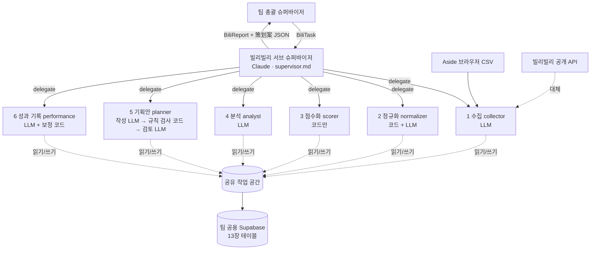

# 에이전트 아키텍처 — 빌리빌리 서브 슈퍼바이저 (수직 구조, 에이전트 6개)

> 기획안(Figma) 12장 「에이전트 6개 구조도」와 13장 「데이터베이스 설계」를 빌리빌리 파트에 맞춰 구현한 Proof of Concept.
> 담당: 곽우화 (빌리빌리 파트 전체)

## 1. 구조 선택: 수직(계층형) vs 수평

**수직(계층형 Supervisor) 구조**를 선택했습니다.

| | 수직 (선택) | 수평 |
|---|---|---|
| 모양 | 슈퍼바이저 1 → 에이전트 6. 에이전트끼리 직접 대화하지 않음 | 에이전트끼리 대등하게 메시지를 주고받음 |
| 순서 | 1 수집 → 2 정규화 → 3 점수화 → 4 분석 → 5 기획안 순서가 분명 → 한 곳에서 통제 | 순서를 에이전트끼리 합의해야 해 흔들림 |
| 안전장치 | 슈퍼바이저 단계에서 코드로 강제 (아래 4절) | 지킬 지점이 여러 에이전트에 흩어짐 |
| 데이터 전달 | 공유 작업 공간(Workspace) 하나. 원본 데이터는 대화에 넣지 않고 요약만 전달 | 대화가 에이전트 사이를 오가며 길어짐 |
| 팀 작업 | 플랫폼별 서브 슈퍼바이저가 같은 계약(XxxTask → XxxReport)으로 총괄에 연결 | 경계가 흐려 분담이 어려움 |
| 단점과 완화 | 슈퍼바이저가 병목·단일 실패 지점 → 최대 단계 수 제한, 에이전트 실패 시 경고 후 계속, 결과는 코드가 조립 | — |



## 2. 에이전트 6개 (기획안 12장과 1:1)

| 단계 | 코드 | 프롬프트 | LLM 이 하는 일 | 코드가 하는 일 (도구) | DB (13장) |
|---|---|---|---|---|---|
| 1 수집 | `agents/workers/w1_collector.py` | `w1_collector.md` | 출처 선택(Aside / API / 스냅샷), 데이터 품질 보고 | `load_aside`, `collect_popular_games`, `collect_trending`, `load_ranking_snapshot` | raw_snapshots |
| 2 정규화 | `w2_normalizer.py` | `w2_normalizer.md` | 사전에 없는 게임 이름을 별칭 후보로 제안 | (먼저 실행) 중복 제거·제목+화제 태그로 game_id 부여 / `list_unmatched_titles`, `resolve_game` | videos, game_aliases |
| 3 점수화 | `w3_scorer.py` | — (LLM 없음) | — | Score_bili = 수요 + 아웃라이어 + 신선도 − 경쟁도, Aside 공식 활동 가산 | topic_scores |
| 4 분석 | `w4_analyst.py` | `w4_analyst.md` | 08장 기능 해석: 이벤트 레이더·핫키워드 선행 신호·반응률·길이·제목 진단·해외 트렌드 카드, 주장마다 근거 | `get_event_signals`, `get_hot_keyword_signals`, `get_engagement_ranking`, `get_duration_type_distribution`, `get_title_benchmark`, `diagnose_title`, `get_top_titles`, `lookup_evidence` | analyses |
| 5 기획안 | `w5_planner.py` | `w5_plan_writer.md`, `w5_plan_reviewer.md` | 작성: 훅 3종·구간 스크립트·제목 3개·썸네일·저작권(간체 중국어) / 검토: 독립 의미 검토 | `get_plan_context`, `lookup_evidence` / `run_rule_checks`(plan_rules), 실패 시 1회 수정 루프 | plans |
| 6 성과 기록 | `w6_performance.py` | `w6_performance.md` | 기획안 대비 성과 해석, 다음 행동 제안 | `list_uploads`, `get_checkpoints`, `propose_weights`(8개 이상, 적용은 사람) | uploads, performance, score_weights |

슈퍼바이저 프롬프트는 `prompts/supervisor.md`. 시스템 프롬프트는 모두 한국어, 策划案 본문만 간체 중국어.

## 3. 데이터 수집 — Aside 브라우저

빌리빌리 랭킹(`ranking/v2`)과 영상 상세(`view`) API 는 일반 HTTP 요청에 봇 차단(-352, 412)이 걸려 Python 에서 자동 수집할 수 없습니다.
그래서 **사용자가 Aside 브라우저로 수집 → CSV → 수집 에이전트가 읽기** 흐름을 1순위로 둡니다(수업 안내 방식).

```
사용자 ─ Aside 브라우저 ─ bilibili.com (실제 브라우저라 랭킹·화제 태그·공식 활동이 정상 동작)
              │ CSV 내보내기 → data/aside/
              ▼
   1 수집 에이전트 ── load_aside ─┬─ 신선(≤48시간) → 사용, 출처 'aside'
                                 └─ 없음·오래됨  → 공개 API(종합 인기·핫서치)로 대체
```

| 파일 (data/aside/) | 내용 | 쓰는 에이전트 |
|---|---|---|
| `bilibili_YYYY-MM-DD.json` (**1순위**, Aside 크롤러 출력) | 영상(조회·좋아요·코인·즐겨찾기·공유·댓글·탄막, 공식 활동 mission_id·event_tags, 화제 태그), 핫키워드(is_game) | 1→2→3→4 |
| `*videos*.csv` | bvid, 제목, 파티션, 길이, 게시 시각, 조회·좋아요·코인·즐겨찾기·공유·댓글·탄막, 화제 태그 | 1→2→3→4 |
| `*hot_keyword*.csv` | 순위, 키워드, 열기 | 3, 4 |
| `*event*.csv` | 공식 활동·화제 이름, id, 참여 영상 수, 조회수 합 | 3(이벤트 가산), 4 |
| `*performance*.csv` | bvid, 수집 시각, 조회·좋아요·코인·즐겨찾기·댓글 | 6 |

- 열 이름은 영어·한국어·중국어 모두 인식(`tools/aside_import.py` 별칭표), 인코딩은 UTF-8(BOM) → GB18030 → CP949 자동 판별.
- **신선도**: 게시 30일(`BILI_MAX_VIDEO_AGE_DAYS`)이 넘은 영상은 2 정규화에서 뺍니다. 2026-11-25 Aside 수집에서 '游戏区排行榜' 45개가 모두 2025-03-28~04-02 게시물이었는데, 구 카테고리 랭킹(`ranking/region`)이 2025-04 에 갱신을 멈춘 것과 같은 목록입니다(조회수는 최신, 목록은 고정). 신선한 영상이 30개 미만이면 공개 API 종합 인기로 보충하고, Aside 핫키워드가 20개 미만이면 공개 API 핫서치로 보충합니다(Aside 순위를 앞에 둠).
- Aside 가 계산한 반응률·제목 진단은 쓰지 않고 원본 수치로 다시 계산합니다(Aside 반응률은 댓글을 포함해 공식이 다름).
- 게임 외 파티션(影视·二次元 등)은 버리고, `aid` 는 표 프로그램에서 지수 표기로 깨지기 쉬워 `bvid` 를 키로 씁니다.
- Aside 는 사용자 계정으로 동작하므로 수집 빈도를 낮게 유지하고 빌리빌리 이용 약관을 지킵니다.

## 4. 코드가 막는 것 (수직 구조의 가드레일)

| 상황 | 막는 곳 |
|---|---|
| 앞 단계 없이 뒤 단계 호출 (예: 점수 전 분석) | `supervisor._delegate` — `requires` 체인 1→2→3→4→5 |
| 수집 0개인데 다음 단계 진행 | `_delegate` — 수집 에이전트를 다시 부르도록 오류 반환 |
| 같은 에이전트 중복 실행 | `_delegate` |
| 기획안 규칙 위반(구조·시간·저작권·'仅供排序参考'·데이터 출처·예측 표현) | `tools/plan_rules.check_plan` (5단계 안에서 자동) |
| 검토 불합격 | 5단계 안에서 작성 에이전트에게 1회 되돌림, 그래도 실패면 `needs_review` |
| 최종 요약의 조회수 예측 표현 | `check_report_submission` — 제출 거부 |
| 가중치 자동 적용 | 6단계는 보정안만 저장, 적용은 사람 승인 |

## 5. 팀 공용 DB (13장)

`tools/team_db.py` 가 실행 결과를 13장 테이블 행으로 만듭니다(`platform = 'bilibili'`). `python main.py ... --db-export` 로 JSON 저장, `--db-push` 로 Supabase upsert(SUPABASE_URL·SUPABASE_SERVICE_ROLE_KEY 필요). 별칭 사전은 `games`·`game_aliases` 를 읽습니다.

## 6. 남은 과제

- Aside CSV 의 실제 열 이름은 수업 예시 화면 기준으로 맞췄습니다. 새 CSV 를 받으면 `aside_import.COLUMNS` 별칭표로 조정합니다.
- 4 분석 에이전트가 기존 4개 워커(트렌드·반응·제목·현지화)를 합친 것이라 도구가 9개입니다. 품질이 떨어지면 분석 안을 하위 에이전트로 다시 나눌 수 있습니다.
- 6 성과 기록은 업로드·성과 데이터가 쌓여야 보정안이 나옵니다(8개 이상).
