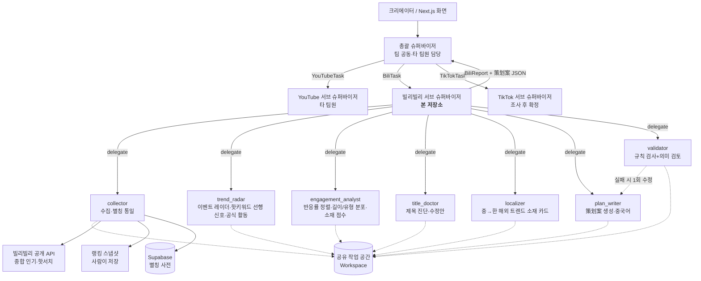

# 에이전트 아키텍처 — 빌리빌리 서브 슈퍼바이저

> 기획안(Figma) 「게임 영상 크리에이터 원스톱 인스피레이션 플랫폼」의 08 빌리빌리 모드를
> **Supervisor 패턴의 멀티 에이전트**로 구현한 Proof of Concept입니다.
> 역할 분담은 기획안(기능별 A/B/C)과 달리 **플랫폼별**로 바뀌었고, 본 저장소는 **빌리빌리 파트** 전체를 담당합니다.

## 1. 전체 구조 (계층형 Supervisor)

## 2. 인터페이스 계약 (`bili_agent/contracts.py`)

| 방향 | 형태 | 주요 필드 |
|---|---|---|
| 총괄 → 빌리빌리 | `BiliTask` | `intent`(trend_scan / game_deep_dive / title_check / event_watch), `game`, `user_title`, `period_days` |
| 빌리빌리 → 총괄 | `BiliReport` | `summary_ko`, `opportunities`(점수 포함), `events`, `title_diagnosis`, `duration_advice`, `overseas_trend_cards`, `alias_candidates`, **`plan`(策划案 JSON)**, **`plan_validation`**, `data_sources`, `agent_trace`, `usage`, `warnings` |

YouTube·TikTok 서브 슈퍼바이저가 같은 모양(`XxxTask → XxxReport`)을 따르면 총괄 슈퍼바이저는 플랫폼을 바꿔 끼우기만 하면 됩니다.
`overseas_trend_cards`는 기획안의 "빌리빌리 → YouTube·TikTok 모드 연결 지점"을 그대로 데이터로 넘기는 필드입니다.

## 3. 워커와 기획안 기능 매핑

| 기획안 08 기능 | 담당 워커 | 결정적 도구(코드) | LLM이 하는 일 |
|---|---|---|---|
| 이벤트 레이더 | trend_radar | `get_event_signals` | 이벤트 종류 판단, 행동 제안 |
| 핫키워드 선행 신호 | trend_radar | `get_hot_keyword_signals` | 블루오션 여부 해석 |
| 공식 이벤트 태그 | trend_radar | `mission_id` 집계 | 참여 권장 여부 |
| 반응률 정렬 | engagement_analyst | `get_engagement_ranking` | 근거 기반 기회 서술 |
| 영상 길이 제안·유형 분포 | engagement_analyst | `get_duration_type_distribution` | 추천 길이와 신뢰도 판단 |
| 소재 점수(10장) | engagement_analyst | `score_games` (Score_bili) | 상위 기회 선택·설명 |
| 제목 진단 | title_doctor | `get_title_benchmark`, `diagnose_title` | 문제점·중국어 수정안 |
| YouTube 모드와의 연결 | localizer | `get_top_titles` | 중→한 현지화, 밈 설명, 각색 팁 |
| 트렌드 수집·정규화(06장 1~2단계) | collector | 공개 API, 별칭 사전 | 데이터 품질 판단, 새 별칭 후보 제안 |
| 기획안 생성(06장 5단계 / 流水线 A-5) | plan_writer | `get_plan_context` | 훅 3종·스크립트·제목 3개·썸네일·저작권 체크리스트 작성(중국어) |
| 검증(流水线 A-6) | validator | `run_rule_checks` (`tools/plan_rules.py`) | 규칙으로 못 잡는 예측 표현·근거 없는 숫자·저작권 위험 검토 |

## 3-1. 팀 流水线设计 A 와의 대응

| 流水线 A 단계 | 본 저장소 |
|---|---|
| 1 采集 · 2 规范化 | collector (YouTube 는 vidIQ·YouTube API, 빌리빌리는 공개 API + 별칭 사전) |
| 3 评分(代码) | `metrics.score_games` — 같은 식, 초기 동일 가중치 |
| 4 分析 | trend_radar · engagement_analyst · title_doctor. 빌리빌리는 자막을 받을 수 없어 '자막 구조 타임라인'은 제외 |
| 5 策划案生成 | plan_writer → `plan` (문서의 策划案 JSON 필드 그대로 + `target_duration_sec`, `platform_extras`) |
| 6 校验 | validator + 코드 규칙 검사. 실패 시 plan_writer 에게 1회 되돌림, 그래도 실패면 `status: needs_review` |
| 산출물 | `outputs/report_*_plan.json` (B 파이프라인 입력), `*_plan.md` (팀 공유 문서) |

- **내용 유형**: 분석 단계는 빌리빌리 특성(헌정곡·밈·e스포츠)을 보기 위해 세분류를 유지하고, 策划案의 `content_type`은 문서의 4개(攻略·实况·分析·评测)로 맞춘다 (`plan_rules.CONTENT_TYPE_MAP`).
- **언어**: 빌리빌리 주 시청자가 중국 사용자이므로 策划案 내용은 간체 중국어. 시스템 프롬프트·내부 요약은 한국어.
- **"점수는 정렬 참고용"**: `score_reference.note = "仅供排序参考，非播放量预测"`를 코드가 채우고, 策划案과 최종 요약 모두에서 조회수 예측 표현을 정규식으로 차단한다(최종 요약은 감지 시 제출 거부).

## 4. 슈퍼바이저 동작

1. 총괄 슈퍼바이저가 `BiliTask`를 보낸다.
2. 빌리빌리 슈퍼바이저(Claude)는 `delegate(worker, instruction)` 도구로 워커를 하나씩 부른다. intent별 기본 계획은 시스템 프롬프트에 있지만, 결과를 보고 순서를 바꾸거나 다시 부를 수 있다.
3. 각 워커는 자기 전용 도구 몇 개와 `submit_findings`만 가진 독립 에이전트다. 슈퍼바이저 대화를 보지 못하므로 슈퍼바이저가 `instruction`에 맥락을 적어 준다.
4. 슈퍼바이저가 `submit_report`를 호출하면, 코드가 워커 결과와 계산값을 합쳐 `BiliReport`를 만든다.

## 5. 설계 원칙

| 원칙 | 구현 |
|---|---|
| **숫자는 코드가, 해석은 LLM이** | 중앙값·배수·점수는 `tools/metrics.py`에서 계산. 보고서의 점수는 LLM 출력이 아니라 계산값을 코드가 붙인다(전사 오류·환각 방지). |
| **원시 데이터는 대화에 넣지 않음** | 수백 개 영상 JSON은 `Workspace`(블랙보드)에 두고, 워커는 도구로 요약만 받는다 → 토큰 절약. |
| **순서는 LLM, 안전장치는 코드** | 수집 전 분석, 기획안 없이 검증, 검증 없이 최종 제출, 예측 표현이 든 제출, 1회를 넘는 기획 수정을 코드가 거부한다. 최대 단계(슈퍼바이저 12, 워커 6). |
| **합법적 수집만** | 로그인·쿠키 위조·서명 우회 없음. 봇 차단(-352)된 랭킹 API는 사람이 브라우저로 저장한 스냅샷만 읽는다. 요청 간 1초 간격. |
| **출처 투명성** | 모든 데이터에 `live` / `snapshot` 출처를 기록하고, 스냅샷이면 `warnings`에 남긴다. |
| **거절 대비** | `fallbacks: "default"`(서버 측 대체 모델), `stop_reason == "refusal"` 처리. |
| **재현 가능한 테스트** | 가짜 LLM(`FakeLLM`)으로 슈퍼바이저 루프와 가드레일을 API 키 없이 검증. |

## 6. 데이터 소스 실측 (2026-11-16)

| 엔드포인트 | 결과 | 사용 |
|---|---|---|
| `x/web-interface/ranking/v2?rid=4` (게임 카테고리 랭킹) | `-352` 봇 차단 | 자동 호출 안 함 → 사람이 저장한 스냅샷 |
| `x/web-interface/ranking/region?rid=4` (구 카테고리 랭킹) | 응답은 오지만 2025-04에서 멈춤 | 사용 안 함 |
| `x/web-interface/popular` (종합 인기) | 실시간, `pid_v2=1008`(游戏)로 필터 | ✅ 주 데이터 |
| `x/web-interface/wbi/search/square` (핫서치) | 실시간 30개 | ✅ 핫키워드 선행 신호 |

## 7. 모델

모든 에이전트: `claude-sonnet-5-5` (팀 결정, `.env`의 `BILI_AGENT_MODEL`로 변경 가능).

## 8. 기획안과 달라진 점 / 남은 과제

- 역할 분담: 기능별(A 데이터·B 프론트·C AI) → 플랫폼별. 본인은 빌리빌리 전체 담당.
- 영상 유형: 기획안 6개 유형에 실측 데이터 비중이 큰 **e스포츠**를 추가(2026-11-16 게임 인기 영상 96개 중 36개, S16 결승 주간).
- 한계: 키워드 규칙 분류라 96개 중 47개가 '기타'로 남고, 별칭 사전(15개 게임)으로 게임을 찾지 못한 영상이 50개다. collector가 `alias_candidates`로 새 별칭을 제안하고 사람이 검토해 사전을 키우는 흐름으로 보완한다.
- 랭킹 API: 자동 수집 불가 → 스냅샷 방식. 공식 데이터 제휴 또는 Open Platform 검토 필요.
- 이벤트 캘린더(수동 관리 vs 자동 수집)는 기획안 '확인 필요' 항목으로 남김. 현재는 `mission_id`와 핫서치로만 감지.
- 점수 가중치: 초기 동일 가중치 → 4주 성과 데이터 누적 후 회귀로 보정(Supabase `bili_video_snapshot`).
