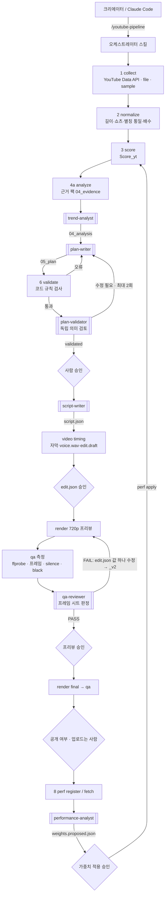

# 아키텍처

## 계약 (팀 총괄 슈퍼바이저 연결)

| 방향 | 형태 | 비고 |
|---|---|---|
| 총괄 → YouTube | `YouTubeTask(intent, topic, source)` | intent: trend_scan / topic_deep_dive / make_video / performance_review |
| YouTube → 총괄 | `YouTubeReport` (`runs/<id>/report.json`) | opportunities, duration_advice, alias_candidates, **plan(plan-v1)**, plan_validation, video, performance, data_sources, agent_trace, warnings |

빌리빌리 `BiliReport` 와 같은 모양이다. 기획안 필드 구조도 plan-v1 로 같고, 텍스트 필드 이름만 `_zh` 대신 접미사 없는 한국어(`line`, `points`, `text`, `style`)다.

## 코드가 막는 것 (가드레일)

| 상황 | 막는 곳 |
|---|---|
| 근거 경로가 없는 주장, 존재하지 않는 근거 경로 | `plan_rules.check_analysis / check_plan` |
| 점수를 코드 값과 다르게 옮김 | `check_plan` (score_reference.topic_score) |
| 조회수·반응 예측 표현 | `plan_rules.PREDICTION_PATTERNS` |
| 저작권 체크리스트 누락(게임 화면·음악·타인 소재) | `check_plan` |
| 검증 통과 전 렌더 | `video.render` (plan status) |
| 프리뷰 측정 PASS + 화면 검토 PASS 없이 최종 렌더 | `video.render` (같은 edit_hash 의 qa.json) |
| 렌더 후 edit.json 이 바뀌었는데 검수 | `qa` (edit.json 일치 항목) |
| CREDITS.txt 에 없는 BGM | `video.check_edit` |
| 결과물 덮어쓰기 | `_next_version` (_v1, _v2 …) |
| 샘플 데이터로 가중치 보정 | `performance.calibrate` (is_sample_data 제외) |
