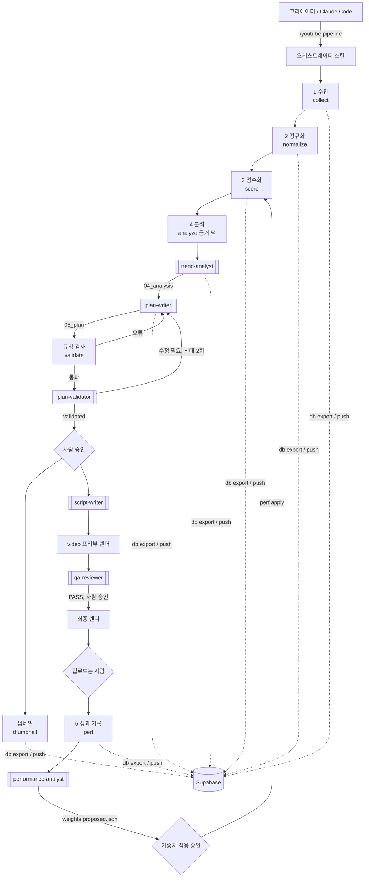

# 아키텍처

기획안 12장 「에이전트 6개 구조도」와 13장 「데이터베이스 설계」를 이 저장소 코드에 맞춘 문서다.

## 1. 에이전트 6개와 코드

기획안의 에이전트 6개는 데이터 흐름 6단계와 하나씩 짝을 이룬다. 숫자를 만드는 단계는 코드가 맡고, 해석과 글쓰기는 Claude 서브에이전트가 맡는다.

| 기획안 에이전트 | 이 저장소에서 맡는 것 | 명령 | 사용 도구 | 쓰는 파일 / DB 테이블 |
|---|---|---|---|---|
| 1 수집 | 코드 | `collect` | YouTube Data API v3, 다른 도구 결과 파일(vidIQ MCP 등) | `01_raw.json` / raw_snapshots |
| 2 정규화 | 코드 | `normalize` | 별칭 사전 `config/alias_dictionary.json` | `02_normalized.json` / videos, channels |
| 3 점수화 | 코드 | `score` | 계산 코드만 사용, LLM 없음 | `03_scores.json` / topic_scores |
| 4 분석 | 코드가 근거 팩을 만들고, trend-analyst가 해석 | `analyze` | Claude (서브에이전트) | `04_evidence.json`, `04_analysis.json` / analyses |
| 5 기획안 | plan-writer가 쓰고, 규칙 검사 코드와 plan-validator가 검토. 썸네일은 이미지 생성 API | `validate`, `review`, `thumbnail` | Claude, OpenAI Images API, FFmpeg | `05_plan.json`, `05_thumbnails/` / plans, thumbnails |
| 6 성과 기록 | 코드가 기록하고, performance-analyst가 해석 | `perf` | YouTube Data API v3 | `performance/` / uploads, performance, score_weights |

영상 생성(`video`, `qa`)은 기획안에서 "추후 논의"로 둔 단계다. YouTube 파트에서 먼저 시험하고 있고, 서브에이전트 script-writer와 qa-reviewer가 맡는다.

## 2. 흐름



## 3. Claude Code와 Claude API

1. Claude Code는 팀이 이 저장소를 개발하고 파이프라인을 시험할 때 쓴다. `.claude/` 아래의 스킬과 서브에이전트는 Claude Code에서만 돈다.
2. 웹 서비스에서는 사용자가 "기획안 만들기"를 누르면 서버가 Claude API를 호출한다. 서브에이전트 지시문(`.claude/agents/*.md`)을 Claude Agent SDK의 에이전트 프롬프트로 옮겨 쓰고, 수집·정규화·점수화는 같은 Python 코드를 서버 작업으로 돌린다.

## 4. 데이터베이스

DB는 Supabase(PostgreSQL)다. 스키마는 `db/schema.sql`이고, 세 플랫폼이 같은 테이블을 쓰며 `platform` 열로 나눈다.

```bash
python -m yt_pipeline db export   # runs/<id>/db/<테이블>.json 으로 행을 만든다 (네트워크 없음)
python -m yt_pipeline db push     # Supabase REST로 upsert (.env 의 SUPABASE_URL, SUPABASE_SERVICE_ROLE_KEY)
```

1. 파일이 원본이고 DB는 웹 화면과 팀원이 같이 보는 사본이다. push를 다시 해도 같은 행은 덮어쓴다.
2. 외래 키 순서(raw_snapshots, channels, videos, topic_scores, analyses, plans, thumbnails, uploads, performance)대로 넣는다.
3. plans 테이블은 행 단위 보안(RLS)으로 로그인한 사용자 본인의 기획안만 읽게 한다. 서비스 롤 키는 서버에서만 쓴다.

## 5. 사용 도구와 운영 요금제

영리 목적으로 운영하면 무료 요금제를 쓸 수 없는 도구가 있다. 유료 기능을 공개하기 전에 아래를 바꾼다.

| 도구 | 용도 | 운영 요금제 |
|---|---|---|
| YouTube Data API v3 | 수집, 성과 기록 | 무료 쿼터 하루 10,000 units. API 서비스 약관 준수 |
| vidIQ (MCP) | 검색량, 아웃라이어 보조 데이터 | 플랜별 크레딧과 상업 이용 조건 확인 |
| Claude Code | 개발 | 팀원별 구독 |
| Claude API | 서비스 안 에이전트 실행 | 사용량 과금 |
| OpenAI Images API | 썸네일 배경 이미지 | 사용량 과금. 상업 이용 조건 확인 |
| Supabase | DB, 파일 저장 | Pro. Free는 1주 동안 쓰지 않으면 일시정지 |
| Vercel | 웹 호스팅, 정기 수집 실행 | Pro. Hobby는 개인·비상업 용도만 허용 |
| FFmpeg | 영상 편집, 썸네일 문구 | 오픈소스 |

## 6. 팀 총괄 슈퍼바이저와의 계약

| 방향 | 형태 | 비고 |
|---|---|---|
| 총괄에서 YouTube로 | `YouTubeTask(intent, topic, source)` | intent는 trend_scan, topic_deep_dive, make_video, performance_review 중 하나 |
| YouTube에서 총괄로 | `YouTubeReport` (`runs/<id>/report.json`) | opportunities, duration_advice, alias_candidates, plan(plan-v1), plan_validation, video(썸네일 포함), performance, data_sources, agent_trace, warnings |

빌리빌리 파트의 `BiliReport`와 모양이 같다. 기획안 필드 구조도 plan-v1로 같고, 텍스트 필드 이름에 `_zh` 접미사가 없다.

## 7. 코드가 막는 것

| 상황 | 막는 곳 |
|---|---|
| 근거 경로가 없는 주장, 없는 근거 경로 | `plan_rules.check_analysis`, `check_plan` |
| 점수를 코드 값과 다르게 옮김 | `check_plan`의 score_reference 검사 |
| 조회수·반응 예측 표현 | `plan_rules.PREDICTION_PATTERNS` |
| 저작권 체크리스트에 게임 화면·음악·타인 소재 항목 누락 | `check_plan` |
| 검증 통과 전 썸네일 생성·렌더 | `thumbnail.run`, `video.render` |
| 프리뷰 측정 PASS와 화면 검토 PASS 없이 최종 렌더 | `video.render` |
| 렌더 뒤 edit.json이 바뀐 상태로 검수 | `qa`의 edit.json 일치 항목 |
| CREDITS.txt에 없는 BGM | `video.check_edit` |
| 결과물 덮어쓰기 | `_next_version` |
| 샘플 데이터로 가중치 보정 | `performance.calibrate` |
