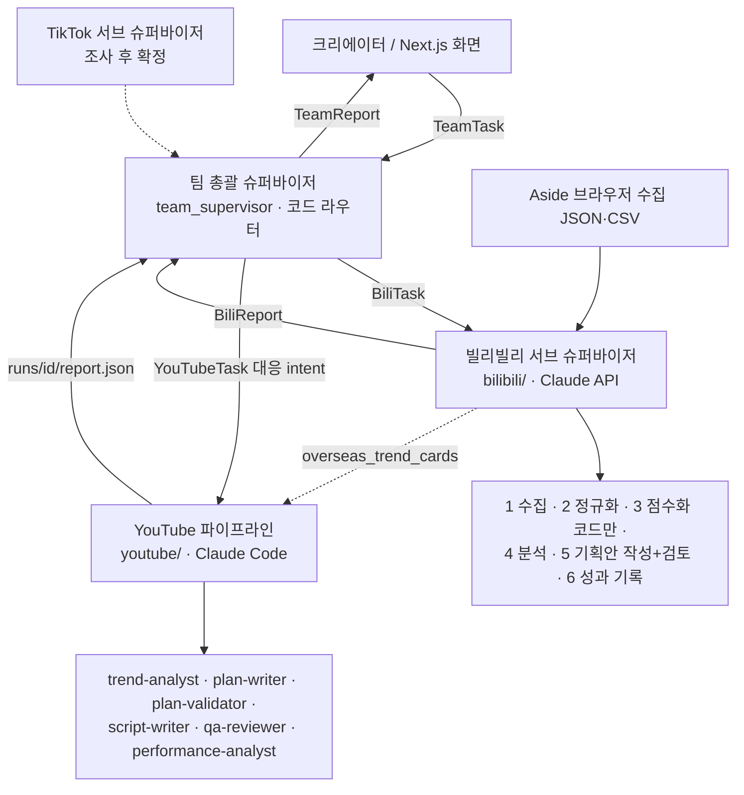

# 팀 아키텍처 — 총괄 슈퍼바이저 + 플랫폼별 서브 슈퍼바이저

> 분기·에이전트 하나하나까지 내려간 그림은 [structure.md](structure.md) (상세 구조도 25개)에 있습니다.

## 1. 계층

## 2. 총괄 슈퍼바이저가 LLM 을 쓰지 않는 이유

- 어느 플랫폼에 보낼지는 팀 intent 표(`contracts.INTENT_MAP`)로 결정된다. 판단할 거리가 없다.
- 판단이 필요한 일(분석·기획·검증)은 각 서브 슈퍼바이저가 이미 한다. 총괄이 다시 LLM 으로 요약하면 비용만 늘고 숫자 전사 오류 위험이 생긴다.
- YouTube 의 LLM 단계는 Claude Code 안에서만 돌아 총괄에서 실행할 수 없다.

## 3. 두 파트의 차이와 흡수 방법

| 항목 | 빌리빌리 | YouTube | 총괄에서 |
|---|---|---|---|
| 에이전트 실행 | Anthropic SDK tool-use 루프 (Python) | Claude Code 서브에이전트 + 스킬 | 빌리빌리는 호출, YouTube 는 실행 결과 읽기 |
| 보고서 | `BiliReport` | `YouTubeReport` | `TeamReport.platforms.
.report` 에 원본 보존 |
| 기획안 언어 | 간체 중국어 (`*_zh`) | 한국어 | `team-plan-view-v1` (text + language) |
| 내용 유형 | 攻略·实况·分析·评测 | 공략·실황·분석·리뷰·밈·하이라이트 | guide · lets_play · analysis · review · meme_highlight |
| 훅 | 先看结果·提问·挑战/反转 | 결과 먼저·질문·도전/반전 | result_first · question · challenge_twist |
| 구간 | 开场·问题·正文·CTA·结尾 | 훅·문제·본문·CTA·엔딩 | hook · problem · body · cta · ending |
| 점수 | `score_reference.score` | `score_reference.topic_score` | `score.value` (플랫폼 간 비교 안 함) |
| 썸네일 | 문구·스타일 (`thumbnail_brief`) | 문구·스타일 + 이미지 생성 프롬프트 → 이미지 생성(설정 시 OpenAI, 과금)·문구 합성 | `thumbnail` (`image_prompt` 포함, 없으면 null) |
| 팀 DB 저장 | `bili_agent/tools/team_db.py` (`platform='bilibili'`) | `yt_pipeline/db.py` (`platform='youtube'`) | 같은 13장 테이블, 스키마 원본 `youtube/db/schema.sql` |
| 플랫폼 고유 | 공식 활동 ID, 태그 | 쇼츠 포맷, 해시태그, 샷 리스트, 근거 경로 | `extras` 에 그대로 보존 |

어댑터(`team_supervisor/plan_adapter.py`)는 모르는 유형 이름을 버리지 않고 `unknown:<이름>` 으로 남기고 경고를 낸다.

## 4. 공통 원칙 (두 파트 모두)

- 숫자는 코드가, 해석은 LLM 이. 점수·배수·중앙값은 결정적 코드로 계산.
- 점수는 정렬 참고용, 조회수 예측 아님. 예측 표현은 정규식으로 차단.
- 코드 규칙 검사 + LLM 의미 검토 2단 검증, 수정 횟수 상한.
- 데이터 출처(live / snapshot / sample) 기록. YouTube 샘플 데이터는 총괄 보고서에도 경고로 전달.

## 5. 장애 격리

한 플랫폼이 실패(API 키 없음, 실행 기록 없음, 예외)해도 다른 플랫폼 결과는 그대로 보고한다. 상태: `ok` / `no_run` / `unsupported` / `error`.
