# 상세 구조도

팀 전체 → 플랫폼 분기 → 에이전트(단계) 하나하나까지 내려가며 그린 구조도입니다. 모든 그림은 현재 코드 기준입니다(함수·파일·프롬프트 이름 그대로).
요약 설명은 [architecture.md](architecture.md), 저장소 안내는 [README](../README.md)에 있습니다.

**목차**

0. [그림 읽는 법](#0-그림-읽는-법)
1. [전체 지도](#1-전체-지도)
2. [팀 총괄 슈퍼바이저](#2-팀-총괄-슈퍼바이저) — 처리 흐름 · intent 라우팅 · 데이터 계약 · 기획안 공통 보기
3. [빌리빌리 분기](#3-빌리빌리-분기) — 전체 · 실행 순서 · intent별 경로 · 에이전트 1~6 · 가드레일
4. [YouTube 분기](#4-youtube-분기) — 전체 · 단계표 · 기획안/검증 · 썸네일 · 영상 생성 · 성과 기록 · 점수 · 가드레일
5. [TikTok 분기 (예정)](#5-tiktok-분기-예정)
6. [팀 공용 DB](#6-팀-공용-db)
7. [플랫폼 사이 연결: 빌리빌리 → YouTube](#7-플랫폼-사이-연결-빌리빌리--youtube)

---

## 0. 그림 읽는 법

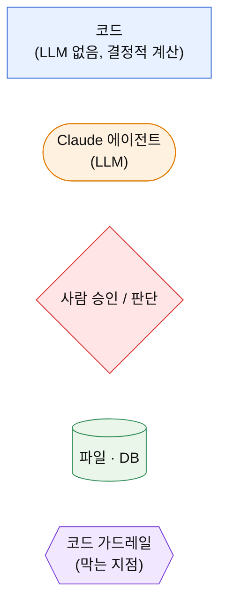

- 실선 화살표: 실제 호출·데이터 이동. 점선 화살표: 선택 경로이거나 참고용 전달.
- 원칙(세 분기 공통): **숫자는 코드가, 해석은 LLM 이** · **점수는 정렬 참고용(조회수 예측 아님)** · **순서·안전장치는 코드가 강제**.

---

## 1. 전체 지도

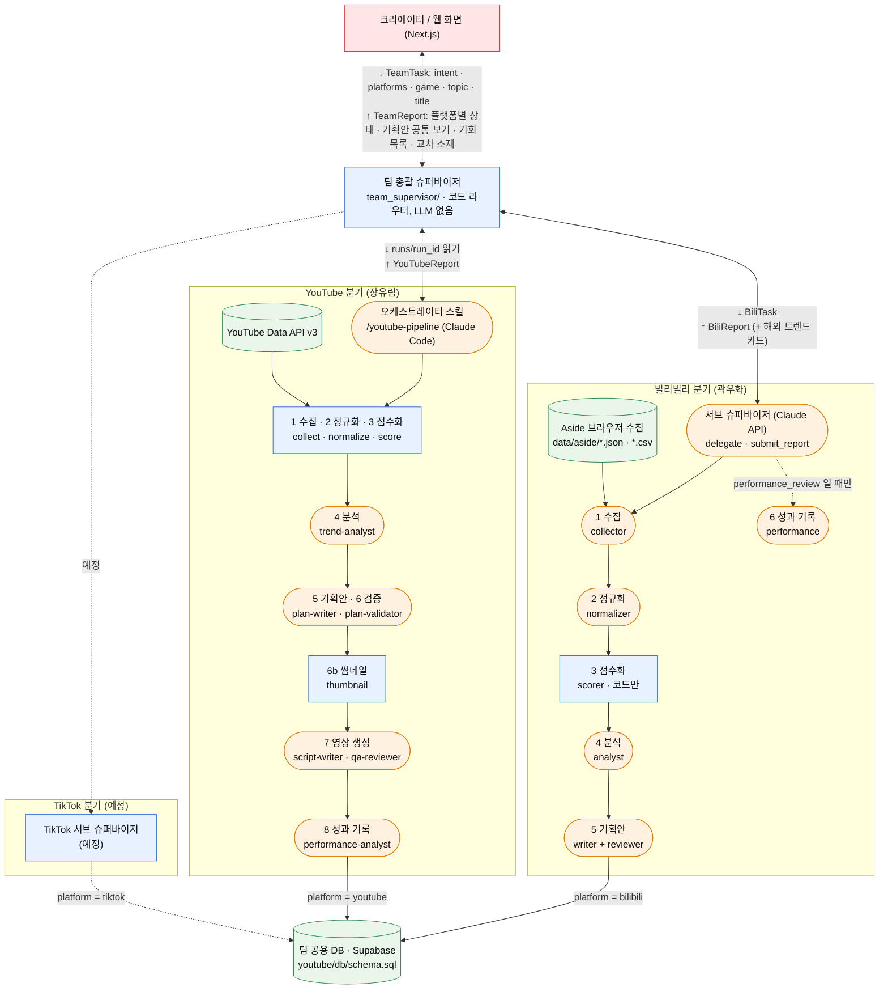

| 분기 | 실행 방식 | 에이전트 수 | 결과 형식 | 코드 |
|---|---|---|---|---|
| 팀 총괄 | Python 코드 라우터 (LLM 없음) | 0 | `TeamReport` | [`team_supervisor/`](../team_supervisor/) |
| 빌리빌리 | Python + Anthropic SDK tool-use 루프, 모델 `claude-sonnet-5-5` | 슈퍼바이저 1 + 에이전트 6 (5 기획안은 작성·검토 2개) | `BiliReport` | [`bilibili/bili_agent/`](../bilibili/bili_agent/) |
| YouTube | Claude Code 스킬 + 서브에이전트 + Python 코드 단계 | 서브에이전트 6 | `YouTubeReport` (`runs/<id>/report.json`) | [`youtube/yt_pipeline/`](../youtube/yt_pipeline/), [`youtube/.claude/`](../youtube/.claude/) |
| TikTok | 조사 후 확정 | — | (같은 계약을 따를 예정) | — |

---

## 2. 팀 총괄 슈퍼바이저

### 2-1. 처리 흐름

`TeamSupervisor.run()` ([supervisor.py](../team_supervisor/supervisor.py)) 한 번이 하는 일입니다. 판단할 거리가 없어서 LLM 을 쓰지 않습니다. ① 플랫폼마다 보내고 상태를 정한 뒤 ② `ok` 인 보고서만 합칩니다.

**① 라우팅과 상태 결정**

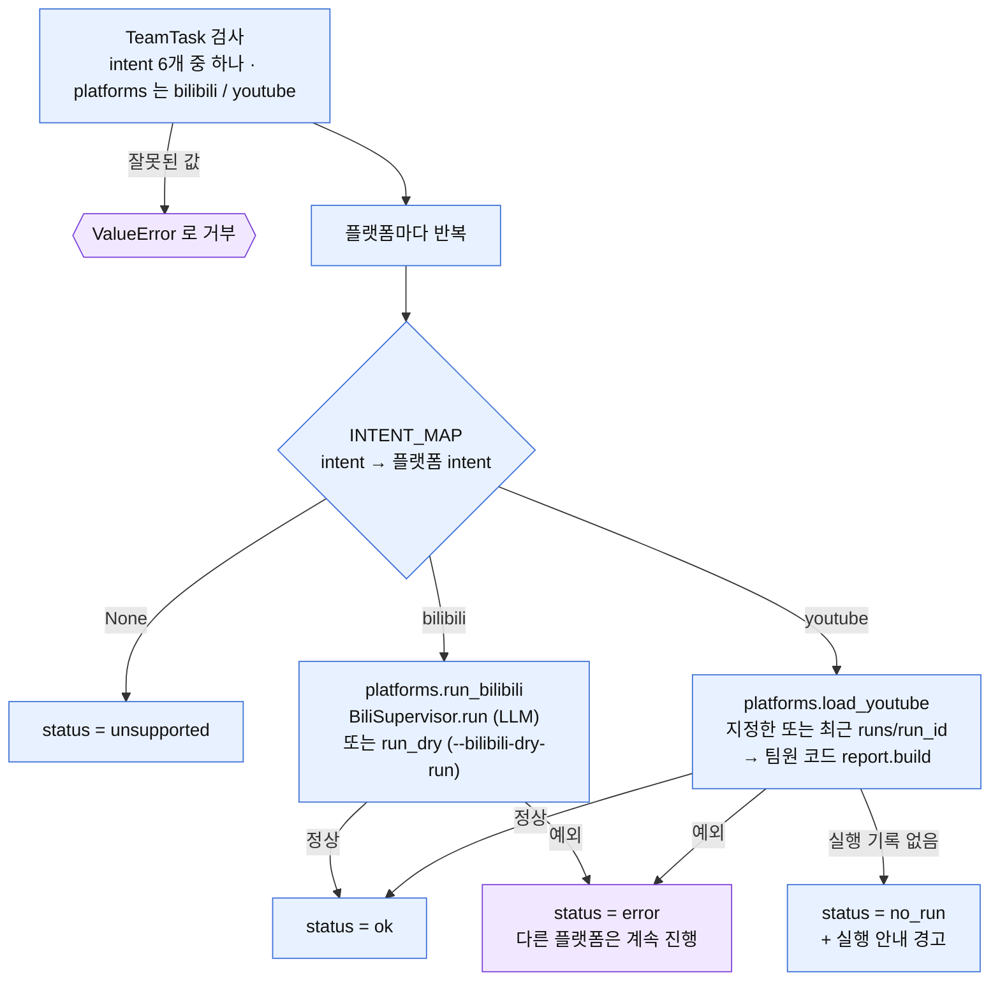

**② 보고서 병합**

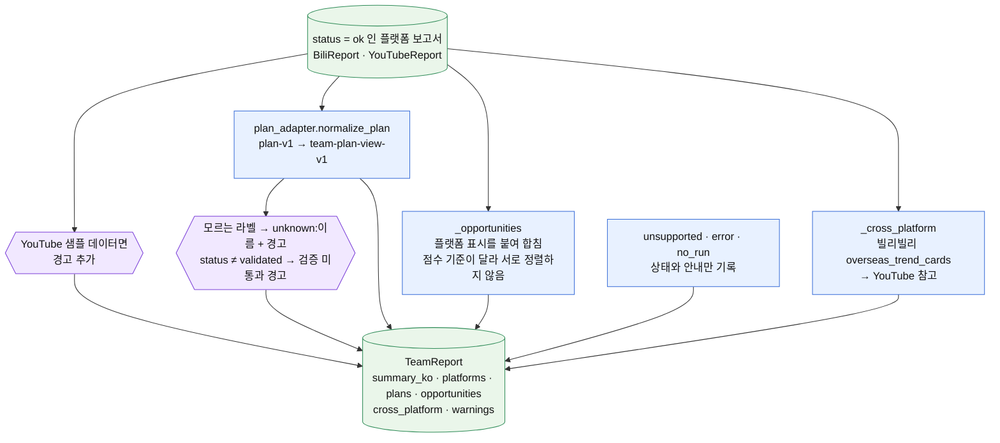

| 상태 | 언제 | 보고서에 남는 것 |
|---|---|---|
| `ok` | 플랫폼 보고서를 받음 | 요약, run_id, 경고 수, 데이터 출처, 원본 보고서 |
| `unsupported` | 그 플랫폼이 이 intent 를 지원하지 않음 (예: YouTube 의 `title_check`) | 안내 문구 |
| `no_run` | YouTube 실행 폴더가 없음 | Claude Code 로 `/youtube-pipeline` 을 먼저 실행하라는 경고 |
| `error` | 실행 중 예외 (API 키 없음 등) | 예외 내용. 다른 플랫폼 결과는 그대로 보고 |

### 2-2. intent 라우팅 (`INTENT_MAP`)

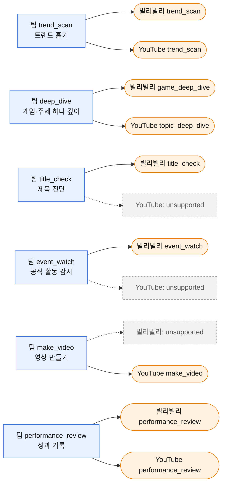

점선 회색 칸은 그 플랫폼이 지원하지 않는 조합이며, 총괄 보고서에 `unsupported` 로 남습니다.

### 2-3. 데이터 계약

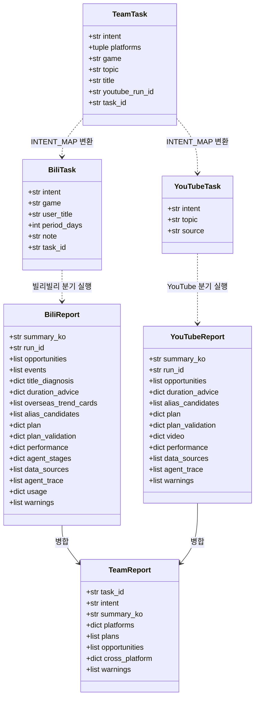

### 2-4. 기획안 공통 보기 (`team-plan-view-v1`)

두 분기의 기획안(plan-v1)은 언어와 라벨이 다릅니다. [plan_adapter.py](../team_supervisor/plan_adapter.py) 가 같은 ID 로 맞춥니다.

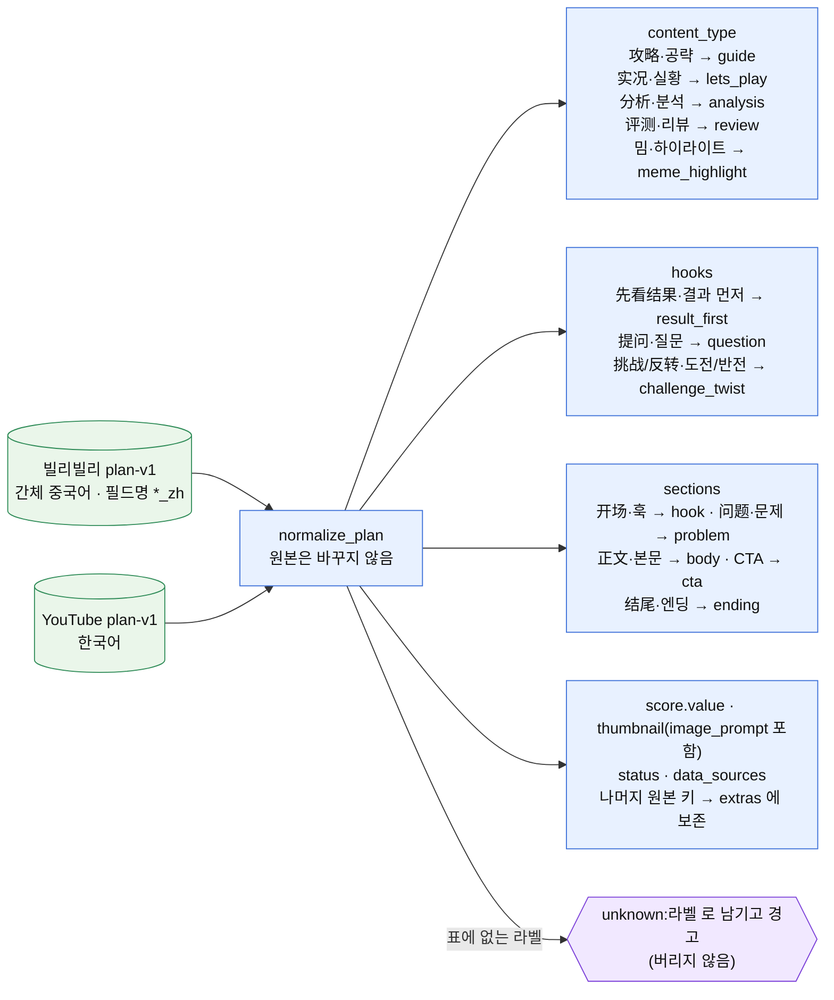

---

## 3. 빌리빌리 분기

기획안 12장 「에이전트 6개 구조도」를 **수직(계층형) Supervisor** 구조로 구현했습니다. 에이전트끼리는 직접 대화하지 않고, 지시는 슈퍼바이저가, 데이터는 공유 작업 공간(Workspace)이 전달합니다.

### 3-1. 전체 구조

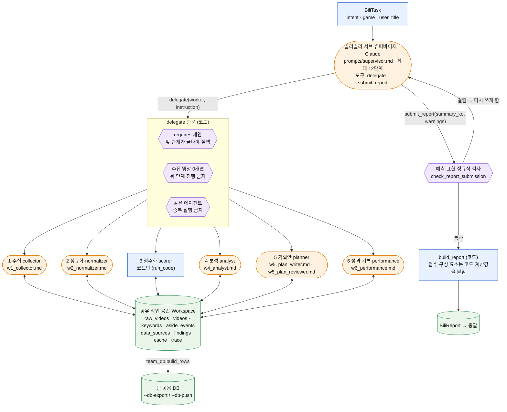

| 에이전트 | 코드 | LLM | 앞 단계(requires) | 도구 | 제출 | DB 테이블 |
|---|---|---|---|---|---|---|
| 슈퍼바이저 | [supervisor.py](../bilibili/bili_agent/agents/supervisor.py) | ✅ | — | `delegate`, `submit_report` | `summary_ko`, `warnings` | — |
| 1 수집 | [w1_collector.py](../bilibili/bili_agent/agents/workers/w1_collector.py) | ✅ | — | `load_aside`, `collect_popular_games`, `collect_trending`, `load_ranking_snapshot` | `summary_ko`, `data_quality_notes` | raw_snapshots |
| 2 정규화 | [w2_normalizer.py](../bilibili/bili_agent/agents/workers/w2_normalizer.py) | ✅ (+코드 pre_run) | collector | `list_unmatched_titles`, `resolve_game` | `summary_ko`, `alias_candidates`, `data_quality_notes` | videos, game_aliases(사람 검토 후) |
| 3 점수화 | [w3_scorer.py](../bilibili/bili_agent/agents/workers/w3_scorer.py) | ❌ | normalizer | (없음, 코드가 바로 계산) | — | topic_scores |
| 4 분석 | [w4_analyst.py](../bilibili/bili_agent/agents/workers/w4_analyst.py) | ✅ | scorer | 9개 (아래 3-7) | `opportunities`, `events`, `duration_advice`, `title_review`, `overseas_trend_cards`, `claims` | analyses |
| 5 기획안 | [w5_planner.py](../bilibili/bili_agent/agents/workers/w5_planner.py) | ✅ ×2 | analyst | 작성: `get_plan_context`, `lookup_evidence` / 검토: `get_plan`, `run_rule_checks`, `lookup_evidence` | plan-v1 / `passed`, `issues` | plans |
| 6 성과 기록 | [w6_performance.py](../bilibili/bili_agent/agents/workers/w6_performance.py) | ✅ | — (별도 경로) | `list_uploads`, `get_checkpoints`, `propose_weights` | `per_video`, `next_actions_ko`, `weight_note_ko` | uploads, performance, score_weights |

### 3-2. 실행 순서 (trend_scan · game_deep_dive)

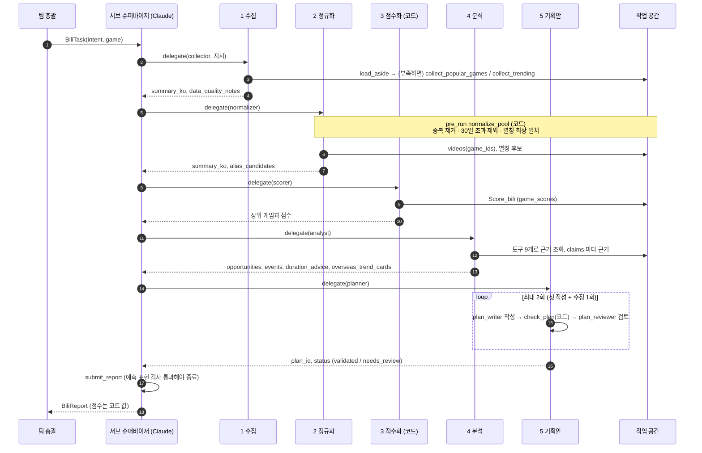

### 3-3. intent별 경로

슈퍼바이저(LLM)가 순서를 정하지만, 앞 단계를 건너뛰는 호출은 코드가 거부합니다. 아래는 LLM 없이 돌릴 때(`--dry-run`)의 기본 계획 `DEFAULT_PLANS` 와 같습니다.

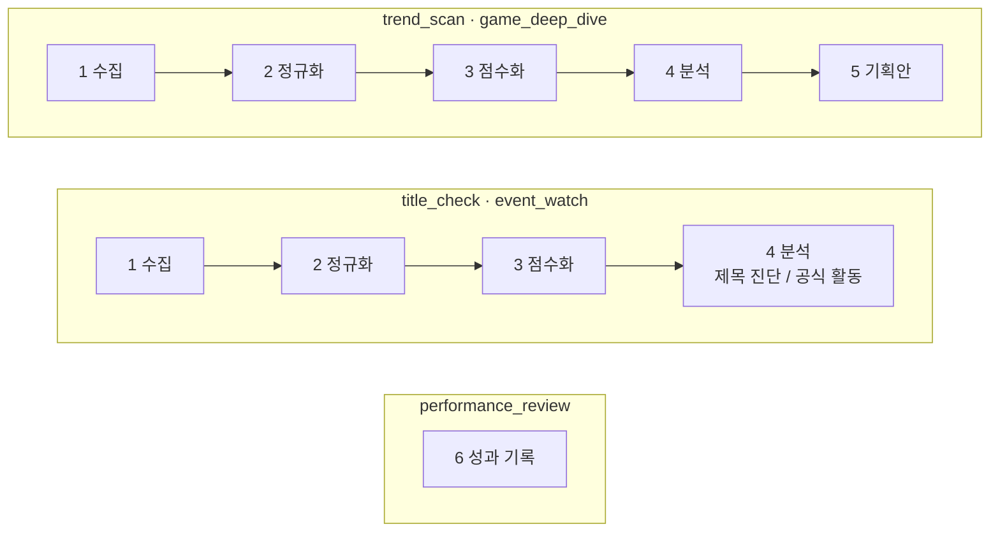

### 3-4. 1 수집 (collector)

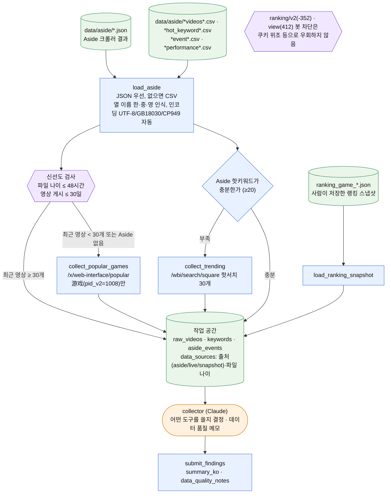

| 항목 | 내용 |
|---|---|
| 입력 | Aside 브라우저 수집 파일(1순위), 빌리빌리 공개 API(대체·보충), 사람이 저장한 랭킹 스냅샷 |
| 코드가 하는 일 | 파일 읽기, 열 이름·숫자(万/亿) 변환, 신선도 판정, 부족분 API 보충, 출처 기록 |
| LLM 이 하는 일 | 상황에 맞게 도구 선택, 데이터 품질 문제를 문장으로 정리 |
| 출력 | `raw_videos`, `keywords`, `aside_events`, `data_sources` → DB `raw_snapshots` |
| 막는 것 | 수집 0개면 다음 단계 진행 금지(슈퍼바이저 관문), 봇 차단 우회 안 함 |

### 3-5. 2 정규화 (normalizer)

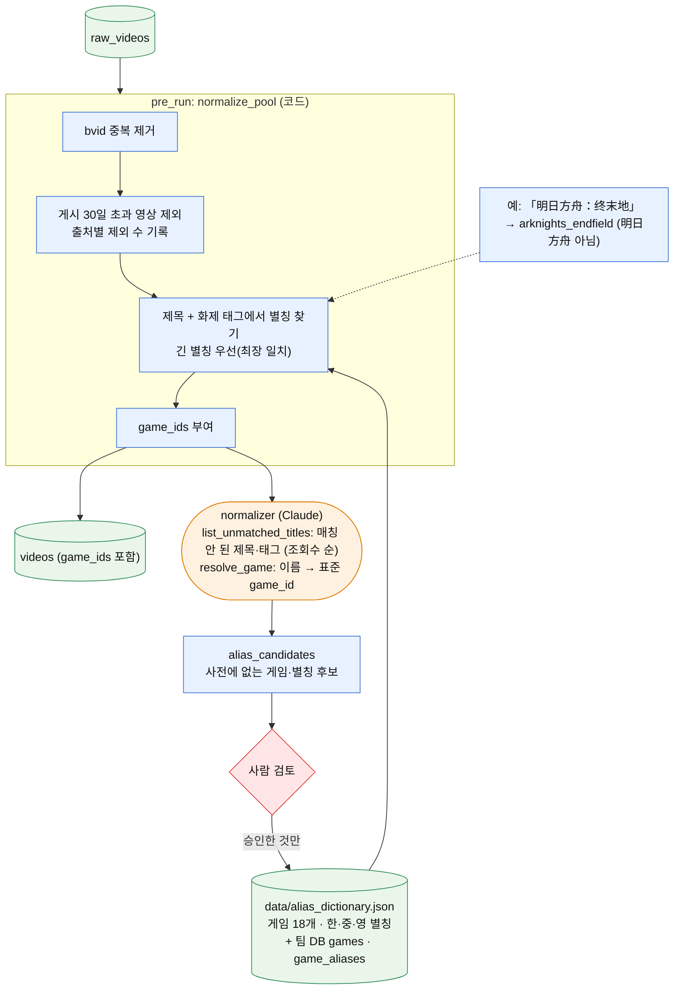

| 항목 | 내용 |
|---|---|
| 입력 | `raw_videos`, 별칭 사전 |
| 코드가 하는 일 | 중복·오래된 영상 정리, 별칭 최장 일치로 게임 매칭 (`alias_store.find_in_text`) |
| LLM 이 하는 일 | 매칭 안 된 영상을 보고 새 게임·별칭 후보 제안 (사전 자동 수정 안 함) |
| 출력 | `videos` → DB `videos` (coins·favorites 포함, 길이 모르면 `is_short = null`) |
| 막는 것 | 별칭 사전은 사람이 승인한 후보만 반영 |

### 3-6. 3 점수화 (scorer, 코드만)

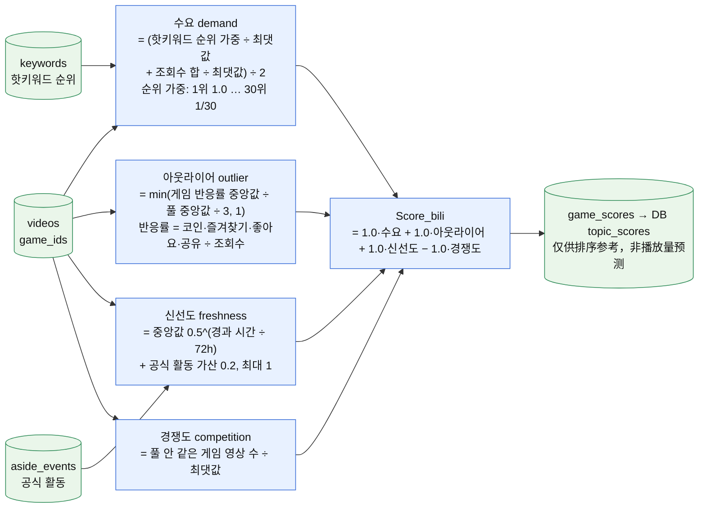

- LLM 을 쓰지 않습니다. 같은 데이터면 항상 같은 점수가 나옵니다.
- 가중치는 기획안대로 처음엔 모두 1.0 ([metrics.py](../bilibili/bili_agent/tools/metrics.py) `WEIGHTS`). 바꾸는 것은 6 성과 기록의 보정안을 사람이 승인했을 때만입니다.

### 3-7. 4 분석 (analyst)

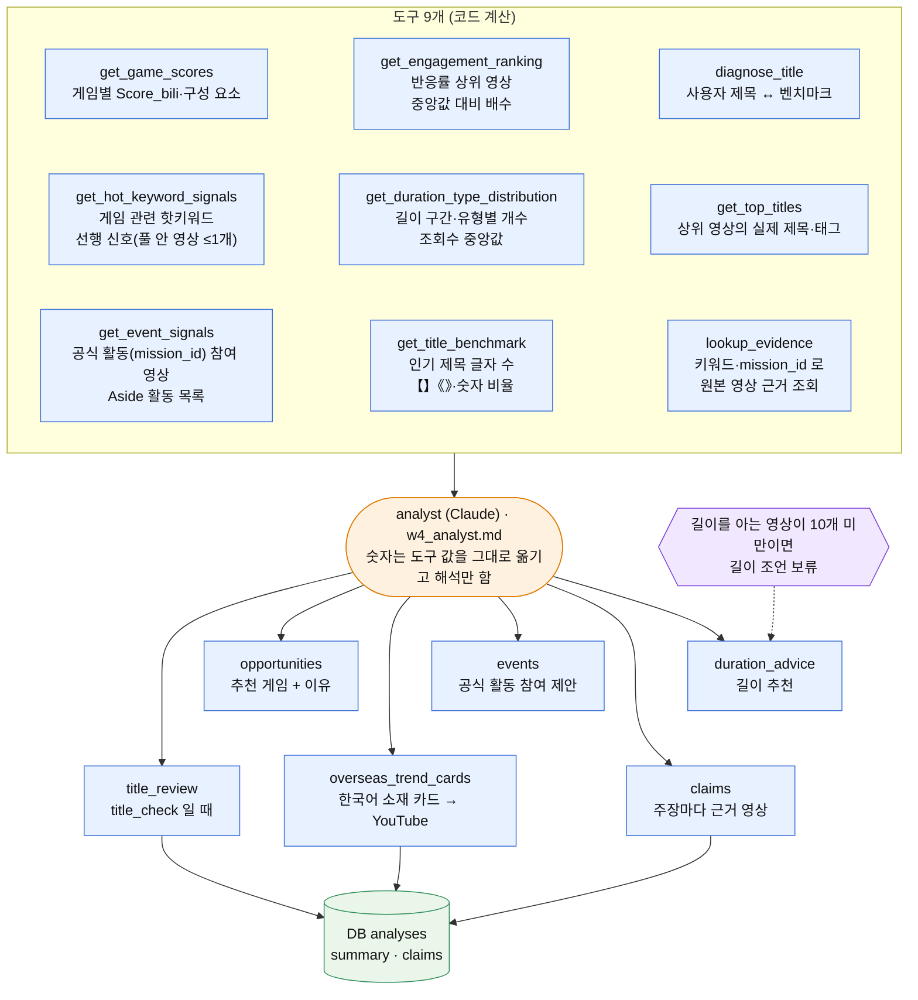

### 3-8. 5 기획안 (planner: 작성 + 검토)

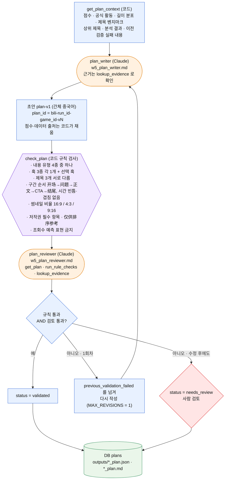

### 3-9. 6 성과 기록 (performance)

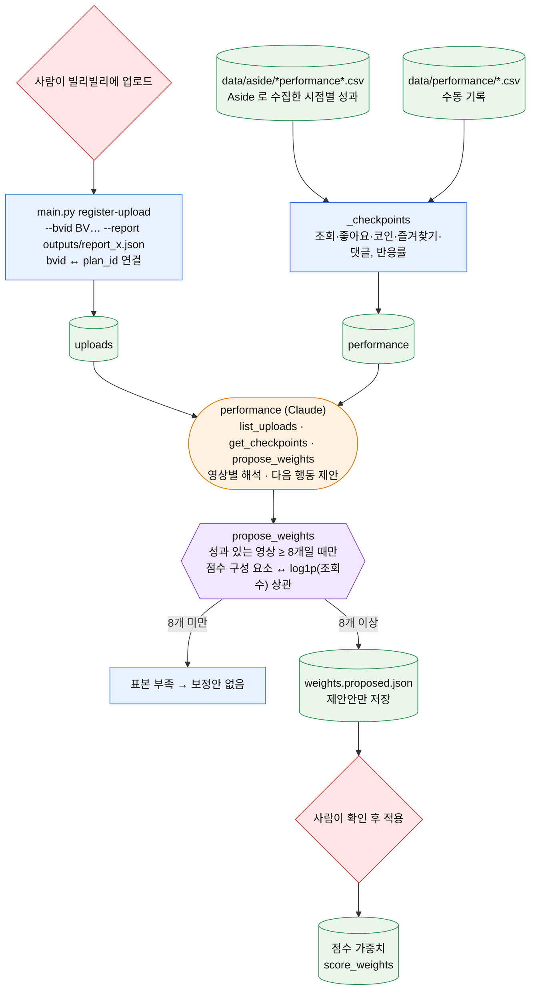

### 3-10. 빌리빌리 가드레일 모음

| 상황 | 막는 곳 (코드) |
|---|---|
| 앞 단계 없이 뒤 단계 호출 (예: 정규화 전에 분석) | `supervisor._delegate` 의 `requires` 체인 |
| 수집 영상 0개인데 계속 진행 | `_delegate` 의 no-data 관문 |
| 같은 에이전트 중복 실행 | `_delegate` |
| 오래된 데이터(랭킹 2025-04 고정 등) 사용 | `load_aside` 신선도(48시간), `normalize_pool` 30일 필터 + API 보충 |
| 보고서·기획안의 조회수 예측 표현 (중·한) | `plan_rules.PREDICTION_PATTERNS` → `check_report_submission`, `check_plan` |
| LLM 이 점수를 잘못 옮김 | `build_report`·`assemble_plan` 이 코드 계산값을 덮어씀 |
| 검증 실패한 기획안을 통과로 표시 | 규칙 검사 AND 검토 둘 다 통과해야 `validated`, 수정 1회 상한 |
| 가중치 자동 변경 | 보정안은 파일로만, 적용은 사람 |
| 무한 루프·비용 폭주 | 슈퍼바이저 최대 12단계, 에이전트 최대 6단계, 호출별 토큰·비용 기록(`usage`) |
| 봇 차단 우회 | 하지 않음: 차단된 API 는 Aside 수집·사람 저장 스냅샷으로 대체 |

---

## 4. YouTube 분기

Claude Code 의 오케스트레이터 스킬(`/youtube-pipeline`)이 코드 단계와 서브에이전트 6개를 순서대로 부르고, 중요한 지점마다 멈춰 사람 승인을 받습니다. 상세 설계: [youtube/docs/architecture.md](../youtube/docs/architecture.md), 단계·멈춤 지점: [SKILL.md](../youtube/.claude/skills/youtube-pipeline/SKILL.md).

### 4-1. 전체 흐름

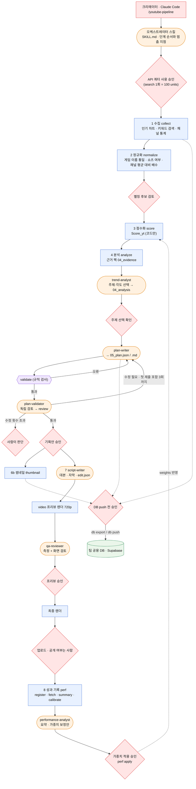

### 4-2. 단계표

| # | 단계 | 맡는 쪽 | 명령 / 에이전트 | 산출물 (`runs/<id>/`) | DB 테이블 | 사람 승인 |
|---|---|---|---|---|---|---|
| 1 | 수집 | 코드 | `data --source api` (`collect`) | `01_raw.json` | raw_snapshots | API 쿼터 사용 전 |
| 2 | 정규화 | 코드 | `normalize` | `02_normalized.json` | videos, channels | 별칭 후보 검토 |
| 3 | 점수화 | 코드 | `score` | `03_scores.json` | topic_scores | — |
| 4 | 분석 | 코드 + trend-analyst | `analyze` → 에이전트 | `04_evidence.json`, `04_analysis.json` | analyses | 주제 선택 확인 |
| 5 | 기획안 | plan-writer | 에이전트 | `05_plan.json`, `05_plan.md` | plans | — |
| 6 | 검증 | 코드 + plan-validator | `validate` → 에이전트 → `review` | `06_validation.json` | plans.status | **기획안 승인** |
| 6b | 썸네일 | 코드 + 이미지 생성 API | `thumbnail` | `05_thumbnails/thumb_vN.png/.json` | thumbnails | 비용 승인, 썸네일 선택 |
| — | DB 저장 | 코드 | `db export`, `db push` | `db/*.json`, Supabase | 전체 | push 전 |
| 7 | 영상 생성 | script-writer + 코드 + qa-reviewer | `video timing/render`, `qa` | `07_video/` | — | edit.json·프리뷰 승인, **공개 여부** |
| 8 | 성과 기록 | 코드 + performance-analyst | `perf register/fetch/summary/calibrate` | `performance/` | uploads, performance, score_weights | 가중치 적용 |

### 4-3. 5 기획안 · 6 검증

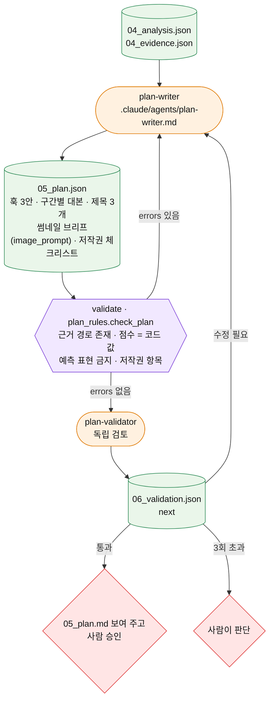

### 4-4. 6b 썸네일

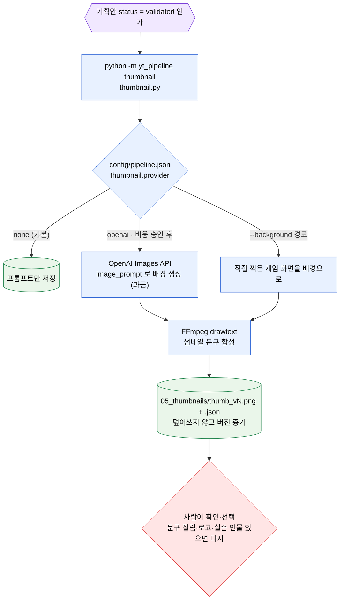

### 4-5. 7 영상 생성

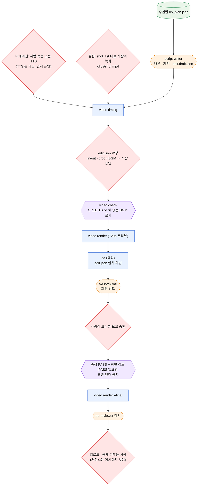

### 4-6. 8 성과 기록

```mermaid
flowchart TB
    R["perf register<br/>영상 ↔ 기획안 연결"]:::code --> F["perf fetch / perf manual<br/>24시간 · 72시간 · 7일 조회수"]:::code
    F --> S["perf summary"]:::code
    S --> PA(["performance-analyst<br/>요약 · 해석"]):::llm
    S --> CA{{"perf calibrate<br/>샘플이 아닌 영상 ≥ 8개일 때만<br/>항목 점수 ↔ log10(72시간 조회수) 상관<br/>가중치 0.2~2.0 으로 자름"}}:::guard
    CA --> PR[("config/weights.proposed.json")]:::store
    PR --> H{"팀 확인 후 perf apply"}:::human
    H --> W[("config/pipeline.json<br/>score.weights")]:::store

    classDef code fill:#e8f1ff,stroke:#3b6fd8,color:#111
    classDef llm fill:#fff1e0,stroke:#e07b00,color:#111
    classDef human fill:#ffe5e5,stroke:#d33,color:#111
    classDef store fill:#eaf6ea,stroke:#2e8b57,color:#111
    classDef guard fill:#f1e8ff,stroke:#7b3fd8,color:#111
```

### 4-7. 점수 Score_yt

```mermaid
flowchart LR
    D["수요<br/>시간당 조회수 합 ÷ 최댓값 과<br/>차트·검색 순위 가중(1위 1.0 … 50위 0.02) ÷ 최댓값 의 평균"]:::code --> S
    O["아웃라이어<br/>영상 조회수 ÷ 채널 평균 조회수 의 중앙값 ÷ 5<br/>(5배 이상이면 1)"]:::code --> S
    F["신선도<br/>중앙값 0.5^(게시 후 경과 시간 ÷ 72h)"]:::code --> S
    C["경쟁도<br/>같은 게임 영상 수 ÷ 최댓값"]:::code --> S
    S["Score_yt = w1·수요 + w2·아웃라이어 + w3·신선도 − w4·경쟁도<br/>가중치 초기값 1.0 · 범위 −1~3 · 정렬 참고용"]:::code

    classDef code fill:#e8f1ff,stroke:#3b6fd8,color:#111
```

자세한 기준: [youtube/docs/scoring.md](../youtube/docs/scoring.md). 빌리빌리 점수(3-6)와 공식 모양은 같지만 데이터가 달라 **두 플랫폼 점수는 서로 비교하지 않습니다**.

### 4-8. YouTube 가드레일 모음

| 상황 | 막는 곳 (코드) |
|---|---|
| 근거 경로가 없는 주장, 없는 근거 경로 | `plan_rules.check_analysis`, `check_plan` |
| 점수를 코드 값과 다르게 옮김 | `check_plan` 의 score_reference 검사 |
| 조회수·반응 예측 표현 | `plan_rules.PREDICTION_PATTERNS` |
| 저작권 체크리스트에 게임 화면·음악·타인 소재 항목 누락 | `check_plan` |
| 검증 통과 전 썸네일 생성·렌더 | `thumbnail.run`, `video.render` |
| 프리뷰 측정 PASS 와 화면 검토 PASS 없이 최종 렌더 | `video.render` |
| 렌더 뒤 edit.json 이 바뀐 상태로 검수 | `qa` 의 edit.json 일치 항목 |
| CREDITS.txt 에 없는 BGM | `video.check_edit` |
| 결과물 덮어쓰기 | `_next_version` |
| 샘플 데이터로 가중치 보정 | `performance.calibrate` |
| 위험한 명령 자동 실행 | `.claude/settings.json`: API 수집·썸네일 생성·렌더·DB push·가중치 적용은 실행 전에 묻고, `.env` 읽기는 금지 |

---

## 5. TikTok 분기 (예정)

담당 팀원이 합류했고 구조는 조사 후 확정합니다. 세 플랫폼이 같은 계약을 쓰도록, 붙일 자리는 이미 정해 두었습니다.

```mermaid
flowchart LR
    TS["팀 총괄 슈퍼바이저"]:::code -.->|"TikTokTask (예정)"| TT["TikTok 서브 슈퍼바이저<br/>(조사 후 확정)"]:::code
    TT -.->|"TikTokReport · plan-v1"| TS
    TT -.->|"platform = tiktok"| DB[("팀 공용 DB<br/>platform 체크 제약에 tiktok 이미 포함")]:::store

    classDef code fill:#e8f1ff,stroke:#3b6fd8,color:#111
    classDef store fill:#eaf6ea,stroke:#2e8b57,color:#111
```

| 붙일 때 할 일 | 위치 |
|---|---|
| `PLATFORMS` 에 `tiktok` 추가, `INTENT_MAP` 에 TikTok 열 추가 | [team_supervisor/contracts.py](../team_supervisor/contracts.py) |
| 호출부 `run_tiktok` 또는 `load_tiktok` 추가 | [team_supervisor/platforms.py](../team_supervisor/platforms.py) |
| 기획안 라벨(내용 유형·훅·구간)을 공통 ID 표에 추가 | [team_supervisor/plan_adapter.py](../team_supervisor/plan_adapter.py) |
| 보고서는 `opportunities`, `plan`(plan-v1), `plan_validation`, `data_sources`, `warnings` 를 같은 이름으로 | 2-3 데이터 계약 |
| 같은 DB 테이블에 `platform = 'tiktok'` 으로 저장 | [youtube/db/schema.sql](../youtube/db/schema.sql) |

---

## 6. 팀 공용 DB

기획안 13장 「데이터베이스 설계」. 스키마 원본은 [youtube/db/schema.sql](../youtube/db/schema.sql) (Supabase · PostgreSQL)이고, 세 플랫폼이 같은 테이블에 `platform` 열로 나눠 저장합니다. 실선은 외래 키, 점선은 `run_id`·`platform`·`game_id` 로 이어지는 논리적 연결입니다.

```mermaid
erDiagram
    raw_snapshots {
        text id PK "run_id:platform"
        text run_id
        text platform "youtube bilibili tiktok"
        text source "api file aside sample"
        boolean is_sample
        timestamptz collected_at
        jsonb payload
    }
    games {
        text game_id PK
        text name_ko
        text name_en
        text name_zh
    }
    game_aliases {
        text alias PK
        text game_id PK, FK
        text platform
    }
    channels {
        text channel_id PK
        text platform PK
        text title
        bigint subscribers
        double avg_views
    }
    videos {
        text video_id PK
        text platform PK
        text run_id PK
        text_array game_ids
        text channel_id
        text title
        bigint views
        bigint likes
        bigint comments
        bigint coins "bilibili"
        bigint favorites "bilibili"
        integer duration_sec
        boolean is_short
        timestamptz published_at
        double outlier_multiple
        double views_per_hour
    }
    topic_scores {
        text run_id PK
        text platform PK
        text game_id PK
        double demand
        double outlier
        double freshness
        double competition
        double score "sorting only"
        integer videos_in_pool
    }
    score_weights {
        bigint id PK
        text platform
        double w_demand
        double w_outlier
        double w_freshness
        double w_competition
        integer samples
        text approved_by "human"
        timestamptz applied_at
    }
    analyses {
        text analysis_id PK
        text run_id
        text platform
        text game_id
        text summary
        jsonb claims "evidence_refs"
    }
    plans {
        text plan_id PK
        uuid user_id "RLS own plans"
        text run_id
        text platform
        text game_id
        jsonb plan "plan-v1"
        text status "draft validated needs_review"
    }
    thumbnails {
        text file_path PK
        text plan_id FK
        text ratio
        text source
        text prompt
        text overlay_text
    }
    uploads {
        text video_id PK
        text plan_id FK
        text platform
        timestamptz published_at
    }
    performance {
        text video_id PK, FK
        timestamptz at PK
        text source
        bigint views
        bigint likes
        bigint comments
    }

    games ||--o{ game_aliases : "alias"
    plans ||--o{ thumbnails : "thumbnail"
    plans ||--o{ uploads : "upload"
    uploads ||--o{ performance : "checkpoint"
    raw_snapshots ||..o{ videos : "run_id"
    channels ||..o{ videos : "channel_id"
    games ||..o{ topic_scores : "game_id"
    videos }o..o{ topic_scores : "run_id + game_ids"
    topic_scores ||..o{ analyses : "run_id"
    analyses ||..o{ plans : "run_id"
```

**누가 어떤 테이블에 쓰나**

| 테이블 | 빌리빌리 ([team_db.py](../bilibili/bili_agent/tools/team_db.py)) | YouTube ([db.py](../youtube/yt_pipeline/db.py)) | 비고 |
|---|---|---|---|
| raw_snapshots | ✅ 1 수집 (source: aside / live / file) | ✅ 1 수집 | 원본 그대로 jsonb |
| games, game_aliases | 읽기 (별칭 사전 보충) | — | 사람이 관리 |
| channels | — | ✅ 2 정규화 | 아웃라이어 배수 기준선 |
| videos | ✅ 2 정규화 (coins·favorites 포함) | ✅ 2 정규화 | 뷰 `v_reaction_rate` 는 빌리빌리 반응률 |
| topic_scores | ✅ 3 점수화 | ✅ 3 점수화 | 정렬 참고용 |
| analyses | ✅ 4 분석 | ✅ 4 분석 | claims 에 근거 |
| plans | ✅ 5 기획안 | ✅ 5·6 기획안·검증 | RLS: 로그인한 본인 기획안만 |
| thumbnails | — | ✅ 6b 썸네일 | |
| uploads, performance | ✅ 6 성과 기록 | ✅ 8 성과 기록 | |
| score_weights | 사람 승인 후 | 사람 승인 후 | 보정안은 파일로만 만들고 자동 적용 안 함 |

---

## 7. 플랫폼 사이 연결: 빌리빌리 → YouTube

구조는 계층형이지만 수평 연결이 한 곳 있습니다. 빌리빌리에서 반응이 좋은 소재를 한국어 카드로 옮겨 YouTube 기획에 참고로 넘깁니다(총괄을 거쳐 전달).

```mermaid
flowchart TB
    T8["get_top_titles<br/>반응률 상위 영상의 실제 제목·태그·배수 (코드)"]:::code --> AN(["빌리빌리 4 분석 analyst<br/>소재를 한국어로 정리"]):::llm
    AN --> CARD[("overseas_trend_cards<br/>source_bvid · title_zh · title_ko · why_ko")]:::store
    CARD --> BR["BiliReport"]:::code
    BR --> TS["팀 총괄 _cross_platform"]:::code
    TS --> TR[("TeamReport.cross_platform<br/>.bilibili_to_youtube")]:::store
    TR -.->|"참고용 · 그대로 복제 금지"| YW(["YouTube plan-writer / 크리에이터"]):::llm

    classDef code fill:#e8f1ff,stroke:#3b6fd8,color:#111
    classDef llm fill:#fff1e0,stroke:#e07b00,color:#111
    classDef store fill:#eaf6ea,stroke:#2e8b57,color:#111
```
